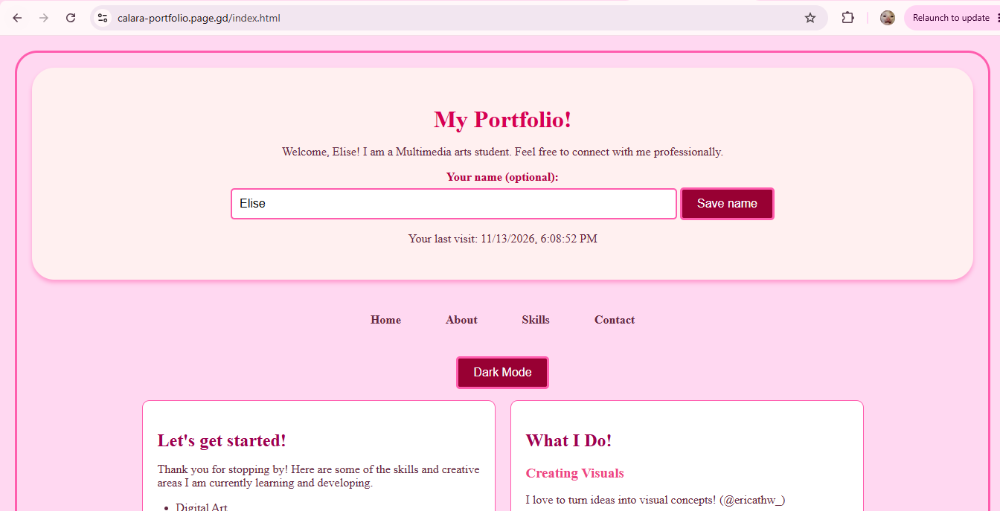
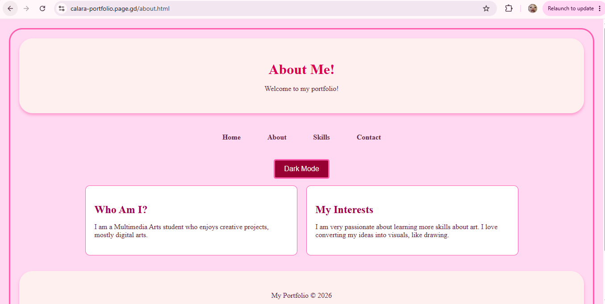
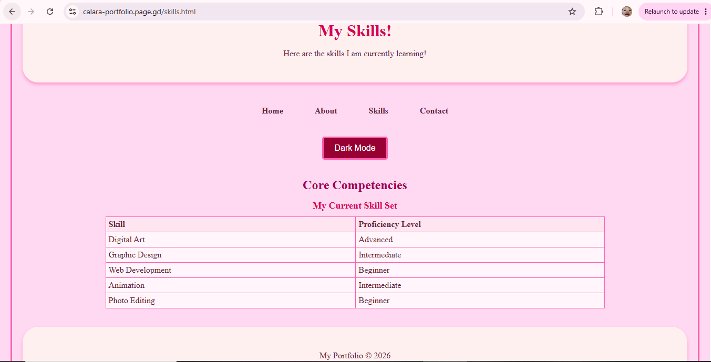
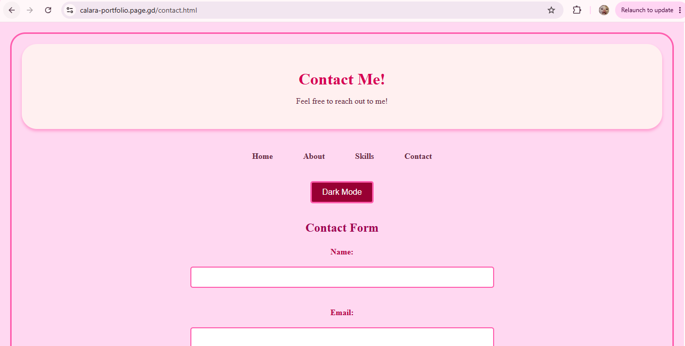
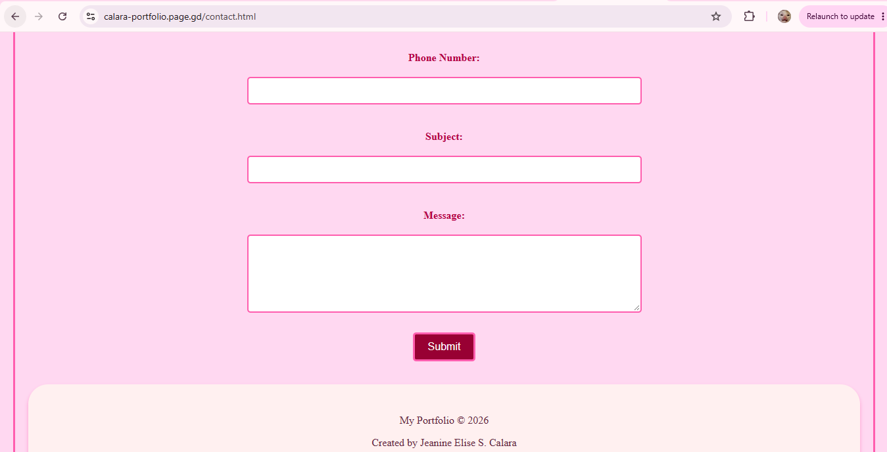

## Project Title
 Calara's Creative Index 
## Overview
 Calara's Creative Index is a personal portfolio created by a Multimedia Arts student, Jeanine Elise S. Calara to showcase her works and introduce herself as a creator. More than just a digital gallery, this website contains a collection of her favorite artworks, alongside an overview of her creative and technical abilities. It’s a straightforward look at her style, skills, and where she’s headed as an aspiring artist. The contact form, however, only validates entries and displays a success message. It does not send messages anywhere.
## Features
 - Four-page website: Home, About, Skills, and Contact.
 - Light and dark mode toggle  with saved theme preference.
 - Visitor name input with locally saved preferences.
 - Last-visit information displayed on the homepage.
 - Skills and proficiency table.
 - Contact form with client-side validation and a success message.
 - Responsive navigation menu for different screen sizes.
## Technologies
 - HTML5
 - CSS3
 - JavaScript
 - Browser Local Storage
## Setup
 - In order to view the website locally, do the following steps:
  1. Download and extract the ZIP file.
  2. Open the extracted folder.
  3. Double-click index.html to launch it in your web browser.

  -  The deployed website can also be accessed through the following link:
     https://calara-portfolio.page.gd/
## Live Demo URL
   https://calara-portfolio.page.gd/
## Screenshots

### Home Page

### About Page

### Skills Page

### Contact Page

## Credits
  - All written content, personal details, and project descriptions on the site were put together by the website creator.
## AI use
 - AI assistance was used for the following purposes:
   1. AI was prompted to generate a deployment readiness checklist for the website. The generated checklist was reviewed, and each applicable item was personally checked and verified by the website owner.
   2. AI was used to review grammar, spelling, and sentence clarity in written documentation. 
   3. AI was used to help explain technical concepts, clarify processes, and provide guidance through project tasks.
   4. AI was used to review the README for gaps by asking questions only, without rewriting it. The questions were used to make independent revisions.

 
